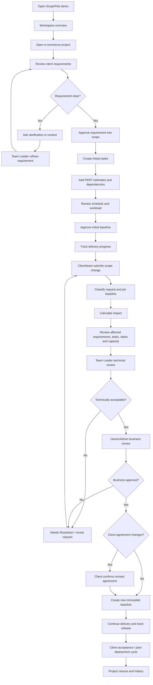
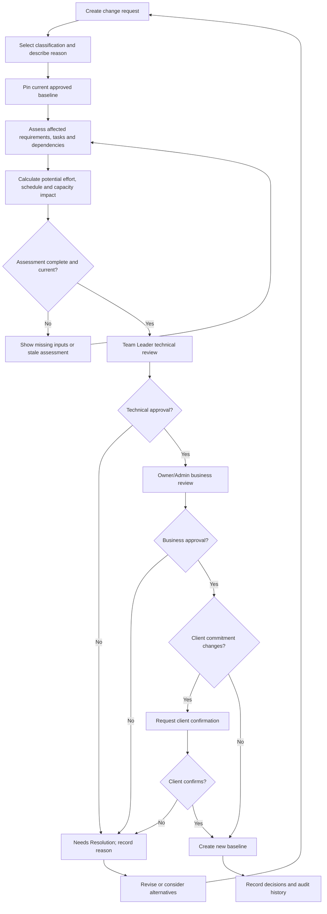
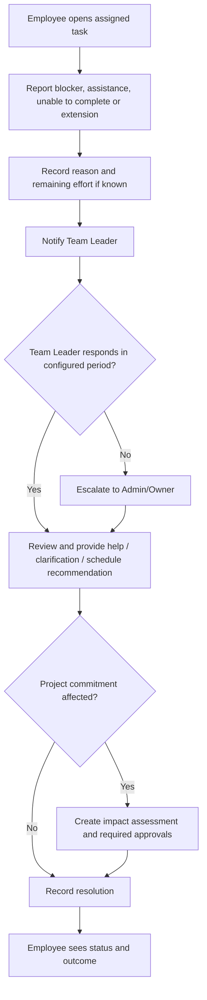
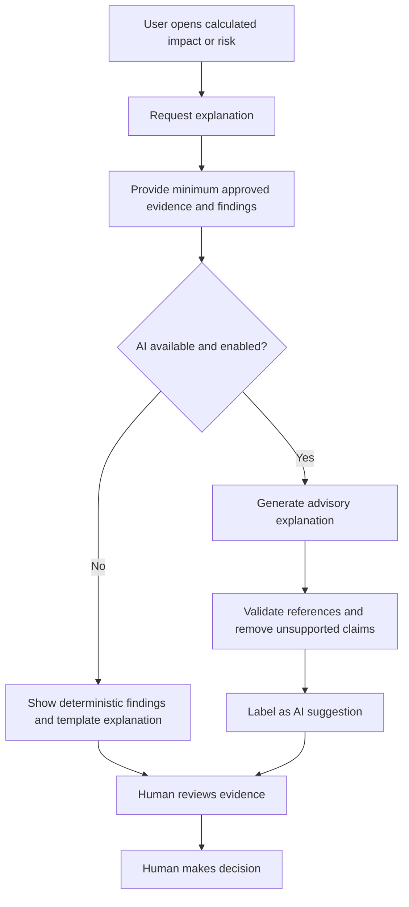

# ScopePilot — User Flow Map

## Purpose
Map the flagship product journey and role handoffs before wireframing. This flow represents the approved product direction; it is not an implementation claim.

## 1. End-to-end flagship flow

## 2. Role handoff map

| Stage | Primary actor | Supporting actor | Product evidence |
|---|---|---|---|
| Requirement submission | Client | Team Leader | Requirement record and acceptance criteria |
| Clarification | Team Leader / Member | Client | Contextual questions and resolved status |
| Delivery planning | Team Leader | Developer/Member | Linked tasks, PERT estimates, dependencies |
| Initial baseline | Owner/Admin | Team Leader | Approved scope snapshot |
| Daily delivery | Developer/Member | Team Leader | Status, actual effort, blockers |
| Change proposal | Client or authorized team member | Team Leader | Request type, rationale and base baseline |
| Impact assessment | ScopePilot calculation engine | Team Leader | Affected work, effort/schedule/capacity projection |
| Technical review | Team Leader | Developer/Member | Feasibility and delivery rationale |
| Business review | Owner/Admin | Team Leader | Priority and commitment decision |
| Client confirmation | Client | Owner/Admin | Revised agreement confirmation |
| Baseline update | ScopePilot after required approvals | Owner/Admin | New immutable baseline and audit record |
| Release and closure | Team Leader / Owner | Client | Release state, acceptance and handover record |

## 3. Change request decision flow

## 4. Employee concern flow

## 5. AI explanation flow

## 6. Navigation flow for prototype

Workspace overview → Project overview → Requirements → Requirement detail → Task board → Task detail → Scope changes → Change detail → Impact assessment → Approval review → Baseline history.

Parallel role entry points:
- Client: Invited project overview → Requirements/progress → Change requests → Client confirmation.
- Developer: My work → Task detail → Clarification/concern → Concern status.
- Team Leader: Project overview → Delivery/workload → Requirements → Technical review → Risks.
- Owner/Admin: Workspace overview → Project commitments → Business approvals → Risks and history.

## 7. Important states to wireframe
- Empty workspace / no projects.
- Project with no requirements.
- Requirement Needs Clarification.
- Requirement approved and linked to tasks.
- Task blocked by prerequisite.
- Capacity conflict / projected delay.
- Change request draft, submitted, Needs Resolution, awaiting technical review, awaiting business approval, awaiting client confirmation, approved and rejected.
- Stale impact assessment because baseline changed.
- AI disabled/unavailable.
- Employee concern awaiting response and escalated.
- Release rolled back / client acceptance pending.
- Closed project read-only.

## 8. Prototype acceptance
A reviewer should be able to follow the e-commerce scenario from requirement to revised baseline, understand who acts at each handoff, see what evidence informs the impact assessment, and understand why a change cannot proceed without the required approvals. The client view must demonstrate a clear visibility boundary from internal agency work.
